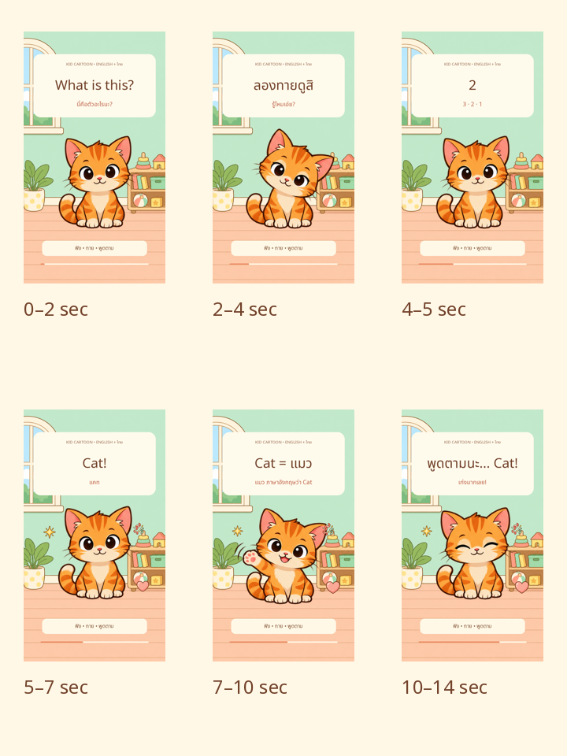

# Kid Cartoon — English + ไทย

โปรเจกต์สร้างคลิปสอนคำศัพท์เด็กด้วยระบบแอนิเมชัน 2D บนเว็บ: **ดูภาพ → What is this? → ให้คิด → เฉลยอังกฤษ → แปลไทย → พูดตาม**

## สถานะตอนแรก

**001 · Cat = แมว · 14 วินาที · 720×1280 / 30 fps**

- มี asset จาก imagegen และสตอรีบอร์ดจาก renderer พร้อมไทม์ไลน์ 6 ฉาก
- เว็บตัวอย่างเล่น/หยุด/เลื่อนเวลา/เริ่มใหม่ได้
- อ่าน Sprite Sheet และช่วงเวลาแต่ละฉากจาก `episode.json`
- ตัวละครใช้ **Sprite Sheet แมวจาก imagegen 16 เฟรม** พร้อมฉากหลังและของตกแต่งโปร่งใส 4 ชิ้น
- มีเสียงพากย์สังเคราะห์ไทย–อังกฤษ 6 ไฟล์ ใช้ซ้ำ 7 ช่วง และ SFX 3 แบบ
- มี renderer ส่งออก MP4 (H.264 + AAC), SRT, storyboard และ poster ด้วย FFmpeg
- มี GitHub Actions สำหรับเรนเดอร์ใหม่ ดู [วิธีตัดต่อ](docs/EDITING.md)
- ยังไม่ได้เปิด GitHub Pages; [ดาวน์โหลดคลิปตอนแรก](episodes/001-cat/exports/001-cat.mp4)



## เปิดตัวอย่างบนเครื่อง

ต้องมี Python 3; Node.js 20+ ใช้สำหรับตรวจและสร้างโครงตอน การเปิดเว็บไม่ต้องติดตั้งแพ็กเกจ ส่วนการเรนเดอร์ใช้ Python dependencies และ FFmpeg ตาม [คู่มือ](docs/EDITING.md)

```bash
python3 -m http.server 8000
```

เปิด `http://localhost:8000` แล้วกด **เริ่มเรียนกัน!** อย่าเปิด `index.html` ด้วย `file://` เพราะเว็บต้องโหลด JSON ผ่าน HTTP

```bash
npm test
```

ทดสอบไทม์ไลน์ ขอบเขตฉาก Sprite Sheet และความครบถ้วนของไฟล์ที่เปิดใช้จริง การตรวจนี้ไม่ได้แทนการทดสอบภาพ/เสียง/การดาวน์โหลดบนเบราว์เซอร์

## โครงสร้าง

```text
engine/                     ระบบเวลาและวาดฉากร่วม
web/                        หน้าเลือกตอนและตัวควบคุม
assets/shared/              ภาพ/เสียงที่ใช้ร่วมหลายตอน
 episodes/                  แต่ละตอนเป็นโฟลเดอร์อิสระ
  index.json                รายการตอนที่เปิดดูได้
  001-cat/
    episode.json            คำศัพท์ ฉาก เวลา และพาธไฟล์
    storyboard.png          สตอรีบอร์ดจาก imagegen
    sprites/                Sprite Sheet
    audio/                  เสียงพากย์และบท
 templates/episode/         แม่แบบข้อมูลตอนใหม่
scripts/new-episode.mjs      สร้างโครงตอนโดยไม่เขียนทับ
 docs/                      แนวทางผลิตและรายการงาน
.github/                    CI และแม่แบบ Issue/PR
```

## เพิ่มตอนใหม่

```bash
npm run new:episode -- 002-dog Dog สุนัข "It’s a dog."
```

คำสั่งสร้างโฟลเดอร์และข้อมูลสถานะ `planned` **ยังไม่เพิ่มเข้าหน้าเลือกตอน** จนกว่าจะมีภาพที่ตรงกับคำศัพท์ ห้ามใช้ภาพแมวแทนสุนัข

1. สร้างสตอรีบอร์ดและภาพตาม [ขั้นตอนผลิต](docs/PRODUCTION.md)
2. ใส่ Sprite Sheet ในโฟลเดอร์ `sprites/` และแก้ขนาดเฟรม/จำนวนคอลัมน์ให้ตรง
3. ใส่เสียงและแก้ `audio` ใน `episode.json` (path อ้างจากโฟลเดอร์ของตอน)
4. เพิ่มตอนใน `episodes/index.json` เมื่อไฟล์ภาพและเสียงพร้อม ตรวจด้วย `npm test` หน้าเว็บปัจจุบันเปิดตอน Cat; เพิ่มตัวเลือกตอนใน player เมื่อต้องการหลายตอน
5. เปิดดูจริง ตรวจคำอ่าน เวลา ภาพ และเสียงก่อนส่งออก

การเปลี่ยนคำศัพท์/เวลาไม่ต้องแก้ engine แต่รูปแบบฉากใหม่ เช่น เกมจับคู่ ต้องเพิ่มโค้ดการวาด

## GitHub Pages (เลือกเปิดภายหลัง)

ใน Settings → Pages เลือกเผยแพร่จาก branch `main` และโฟลเดอร์ `/ (root)` โค้ดใช้ path แบบ relative จึงรองรับ project Pages การตั้งค่านี้ยังไม่ได้ดำเนินการให้ ไม่ใส่ workflow เผยแพร่อัตโนมัติ

## การจัดงานรายตอน

สร้าง Issue ด้วยแม่แบบ **Episode production** แล้วติดตามผ่าน checklist แต่ละตอน มีแผนงานใน [docs/ROADMAP.md](docs/ROADMAP.md) ยังไม่ได้สร้าง GitHub Projects board

ดู [ที่มาของ assets](ASSET_SOURCES.md) และ [Prompt สำหรับภาพ](docs/IMAGEGEN_PROMPTS.md)
